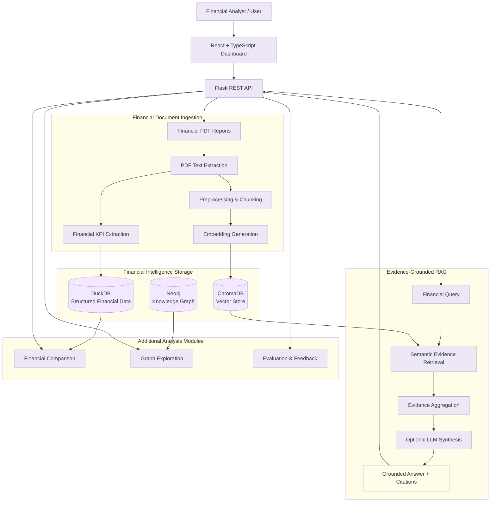

<div align="center">

# LedgerCapital: Financial Intelligence Suite

**AI-powered financial document intelligence with evidence-grounded RAG**

Turn complex financial reports into searchable evidence, structured KPIs, and traceable answers.


[Overview](#overview) · [Features](#key-features) · [Architecture](#system-architecture) · [Tech Stack](#technology-stack) · [Getting Started](#getting-started) · [API](#backend-api) · [Structure](#project-structure)

</div>

---

## Overview

**LedgerCapital** is a full-stack platform for analyzing financial documents using **Retrieval-Augmented Generation (RAG)**, semantic search, structured financial analytics, and knowledge graph integration.

Financial analysis usually means manually reading lengthy annual reports, extracting figures, comparing statements, and hunting for supporting evidence across documents. LedgerCapital centralizes that workflow: it ingests reports, retrieves relevant passages, extracts financial KPIs, and answers natural-language questions with source-backed responses.

### Core Objectives

- Query financial reports in natural language
- Retrieve relevant evidence through semantic search
- Ground every answer in source documents
- Extract and organize financial performance indicators
- Support multi-year and multi-company analysis
- Explore financial entities and relationships as a knowledge graph
- Provide an interactive interface for financial research

---

## Key Features

| Area | Capabilities |
|---|---|
| **Document Processing** | PDF upload and ingestion, PyMuPDF text extraction, preprocessing, chunking, semantic indexing, metadata and source tracking |
| **Evidence-Grounded RAG** | Natural-language queries, ChromaDB semantic search, evidence aggregation, optional LLM synthesis, source citations, explicit handling of insufficient evidence |
| **Financial KPI Intelligence** | Structured KPI extraction and storage in DuckDB |
| **Comparison & Analytics** | Multi-year and company comparisons, profitability analysis, interactive dashboards |
| **Knowledge Graph** | Neo4j integration for financial entities, relationships, and graph visualization |
| **AI Agent Modules** | Query planning, smart retrieval, financial analysis, graph interaction, visualization generation |
| **Evaluation & Monitoring** | Ground-truth datasets, query and agent evaluators, feedback collection, monitoring dashboard |

### Supported Financial Indicators

Revenue · Gross profit · Operating income · Net income · Total assets · Total liabilities · Shareholders' equity · Cash and debt · Operating cash flow · Financial margins

> **Note:** KPI extraction depends on the table formats supported by the parser. It has been tested locally against five synthetic financial reports.

> **Note:** Comparison features depend on the active backend routes and available indexed data. Neo4j features require a configured, running database. Agent modules depend on the active backend integration.

---

## System Architecture

LedgerCapital separates document ingestion, semantic retrieval, structured financial intelligence, graph processing, and presentation into modular layers.


[View architecture diagram source](docs/architecture/ledgercapital-architecture.mmd)



The primary RAG path retrieves evidence from **ChromaDB**. **DuckDB** holds structured financial records, and **Neo4j** provides graph capabilities through separately configured integration modules.

### Workflow

**1. Ingestion**

```text
Financial PDF → Upload → Text Extraction → Preprocessing → Chunking → Embeddings → ChromaDB
                                      └──→ KPI Extraction → DuckDB
```

**2. Query Processing**

```text
Question → Flask API → Query Processing → ChromaDB Search → Evidence
        → Context Aggregation → Optional LLM Synthesis → Grounded Answer + Sources
```

**3. Structured Intelligence:** KPIs extracted from supported financial tables support inspection, year-over-year comparison, and analytics.

**4. Graph & Evaluation:** Relationship exploration, evaluation, and feedback modules sit outside the primary verified retrieval path and require their own integrations to be configured.

---

## Technology Stack

| Layer | Technologies | Purpose |
|---|---|---|
| Languages | Python, TypeScript | Backend and frontend |
| Frontend | React, Vite, Tailwind CSS | Responsive web application |
| Backend | Flask, Flask-CORS | REST API and orchestration |
| Document Processing | PyMuPDF | PDF text extraction |
| Vector Database | ChromaDB | Semantic indexing and retrieval |
| Analytical Database | DuckDB | Structured financial metrics |
| Graph Database | Neo4j | Financial entity relationships |
| LLM Integration | Groq API | Optional answer synthesis |
| Visualization | Recharts, Plotly, Cytoscape | Charts and graph exploration |
| Evaluation | Python modules | Testing, feedback, monitoring |

> The verified RAG core uses ChromaDB's default embedding function. Other embedding and agent modules are included in the project but should not be assumed to run on every request.

---

## Application Modules

| Module | Description |
|---|---|
| **Query Dashboard** | Natural-language analysis with supporting evidence |
| **Document Explorer** | Indexed document discovery and inspection |
| **Comparison Dashboard** | KPI and company performance comparisons |
| **Analytics Dashboard** | Financial insights and interactive visualizations |
| **Knowledge Graph Viewer** | Graph-based relationship exploration |
| **Evaluation Monitor** | Evaluation and feedback monitoring |
| **Admin Panel** | Document upload and application management |

---

## Example Queries

```text
What was Crestline Retail Group's revenue in 2024?
How did Asterion's revenue change between 2022 and 2023?
Compare the financial performance of Orion and Solstice.
Which company recorded the highest operating margin in 2024?
What was Orion's operating income in 2023?
How did Solstice's operating cash flow change over three years?
```

> These examples use **synthetic annual reports** created during development. They do not describe real, publicly traded companies.

---

## Getting Started

### Prerequisites

- Python 3.11
- Node.js and npm
- Git
- Neo4j *(only for graph features)*
- Groq API key *(only for optional LLM synthesis)*

### 1. Clone the repository

```powershell
git clone https://github.com/Dhanyaa-shree/LedgerCapital-Financial-Intelligence-Suite.git
cd LedgerCapital-Financial-Intelligence-Suite
```

### 2. Create and activate a virtual environment

```powershell
py -3.11 -m venv .venv
.\.venv\Scripts\Activate.ps1
```

### 3. Install backend dependencies

```powershell
python -m pip install -r requirements-verified.txt
```

### 4. Configure environment variables

Create a `.env` file in the project root:

```dotenv
GROQ_API_KEY=
GROQ_MODEL=
FRONTEND_ORIGIN=http://localhost:5173
```

Provide values only for the services you plan to use. Graph and advanced modules may need additional configuration.

> **Never commit real API keys or database passwords.**

### 5. Start the backend

```powershell
python verified_server.py
```

The development server is configured for `http://127.0.0.1:5001`. Confirm the active address in the terminal output.

### 6. Start the frontend

In a second terminal:

```powershell
cd frontend
npm install
npm run dev
```

Open the local URL shown by Vite, and make sure the frontend API configuration points to the running Flask backend.

### Windows quick start

`START_VERIFIED_WINDOWS.bat` launches the verified-core workflow. Review the script before running it.

---

## Backend API

| Method | Endpoint | Description |
|---|---|---|
| `GET` | `/api/health` | Backend health status |
| `POST` | `/api/documents/upload` | Upload a financial PDF |
| `POST` | `/api/documents/implement-learning` | Process and index a document |
| `GET` | `/api/documents/parsed` | Retrieve indexed document information |
| `POST` | `/api/kb/search` | Search indexed evidence |
| `POST` | `/api/query` | Evidence-grounded financial Q&A |
| `GET` | `/api/stats` | Index and retrieval statistics |
| `GET` | `/api/financial-kpis` | Retrieve extracted KPI records |
| `POST` | `/api/financial-kpis/extract` | Extract structured KPIs from a document |

Comparison, graph, and evaluation routes are implemented in dedicated modules.

---

## Project Structure

```text
LedgerCapital-Financial-Intelligence-Suite/
├── agents/                  # Planner, smart retriever, crew, tools
├── evals/                   # Ground truth, evaluators, feedback loop
├── frontend/                # Active Vite + React + TypeScript app
│   └── src/                 # components, pages, services, styles
├── knowledge_base/          # Extractors, storage, synthesizers
├── phase1/                  # Ingestion and parsers
├── phase2/                  # Chunking, section classification, signals
├── phase3/                  # ChromaDB, DuckDB, Neo4j setup, retrieval
├── src/                     # PDF and KPI processing utilities
├── tests/
├── tools/
├── verified_server.py       # Verified Flask backend entry point
├── ledger_kpis.py
├── ledger_comparison.py
├── ledger_neo4j_graph.py
├── ledger_query_signals.py
├── feature7_routes.py
├── requirements.txt
├── requirements-verified.txt
└── START_VERIFIED_WINDOWS.bat
```

The active frontend lives in `frontend/src/`. The root `src/` folder contains additional processing utilities and frontend sources from earlier development stages.

---

## Reliability Principles

- **Evidence-grounded responses:** answers rely on retrieved passages, not unsupported model claims.
- **Source traceability:** retrieved evidence carries document metadata and source references.
- **Structured + unstructured:** KPI extraction complements semantic retrieval with numerical data.
- **Modular design:** ingestion, retrieval, analysis, graph processing, and evaluation are separate components.
- **Honest about gaps:** when evidence is insufficient, the system says so instead of fabricating figures.

---

## Screenshots

Add real application screenshots under `docs/screenshots/`. Suggested views:

- Query Dashboard with evidence-grounded answers
- Document Explorer
- Financial Comparison Dashboard
- Analytics Dashboard
- Neo4j Knowledge Graph Viewer
- Evaluation Monitor

---

## Limitations & Roadmap

**Current limitations**

- Primarily configured for local execution
- Some advanced modules need extra service configuration
- Extraction accuracy depends on PDF formatting
- Scanned documents may require OCR
- The fully integrated runtime needs regression testing as modules evolve

**Planned enhancements**

- [ ] Cloud deployment and scalable hosting
- [ ] Broader financial document format support
- [ ] Improved financial entity extraction
- [ ] Graph-enhanced retrieval
- [ ] Automated RAG evaluation
- [ ] CI and automated testing
- [ ] Additional visualizations and reporting
- [ ] Larger multi-company benchmarking

---

## Responsible Use

LedgerCapital is a software engineering and document intelligence project intended for research, learning, and analytical assistance. It does **not** provide professional financial or investment advice. Always verify extracted figures against the original source documents before making financial decisions.

---

<div align="center">

**LedgerCapital: From Financial Documents to Traceable Intelligence**

Built with Python, React, Retrieval-Augmented Generation, and Financial Data Engineering.

</div>
